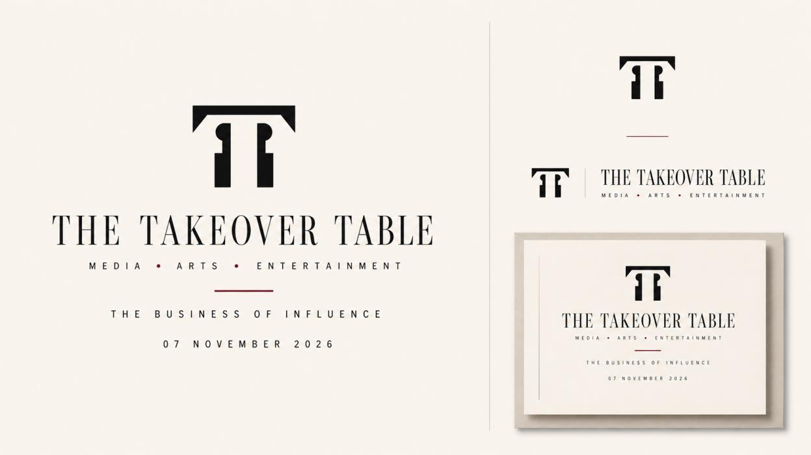
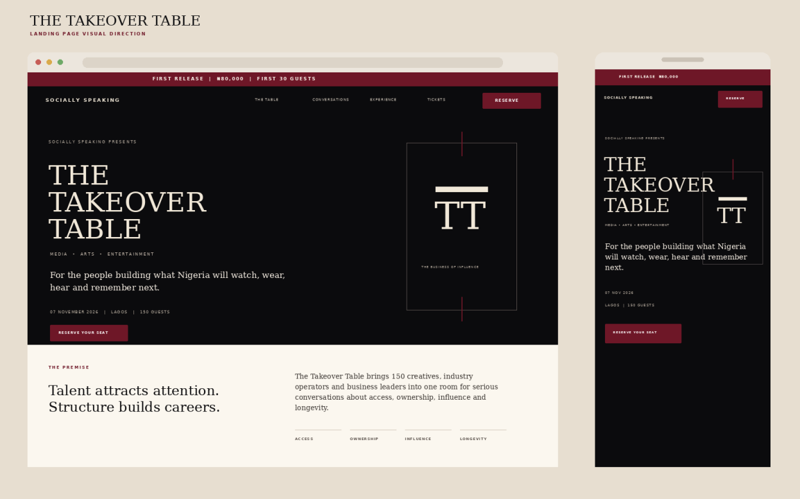

# THE TAKEOVER TABLE | LANDING PAGE BRIEF

## Page 1

THE TAKEOVER TABLE | LANDING PAGE BRIEF
SOCIALLY SPEAKING
The Takeover Table
Landing Page Copy, Ticket Strategy and Visual Direction
Designer and developer brief for the Socially Speaking website
DATE
07 November 2026
LOCATION
Lagos, Nigeria
CAPACITY
150 guests
FOCUS
Media, Arts, Entertainment
THEME
The Business of Influence
TICKET
First release from ₦80,000

### Images

## Page 2

THE TAKEOVER TABLE | LANDING PAGE BRIEF
01 STRATEGIC DIRECTION
The job of the page
The landing page has one job: move a qualified visitor from interest to paid registration. It should not
read like an event brochure. Each section must remove one reason for hesitation and move the
visitor closer to the payment button.
CORE POSITION: A private creative-industry masterclass banquet. The page should sell depth,
access, business intelligence and room quality. Food and aesthetics support the offer. They are not
the offer.
Strategic decisions
• Primary audience: emerging and established professionals across media, arts and entertainment.
• Central promise: understand how creative professionals enter important rooms, build profitable
structures, protect ownership and sustain influence.
• Primary conversion action: Reserve Your Seat.
• Capacity signal: 150 guests only. The smaller room should feel intentional, not artificially scarce.
• Voice: intelligent, direct, selective and confident. Avoid exaggerated luxury language.
• Price presentation: display only the active tier in the hero. Show all tiers after the page has
established value.
LAUNCH REQUIREMENT: Do not open paid registration before confirming one credible headline
speaker, the session structure, exact ticket inclusions, venue area and event schedule. Strong copy
will not repair an incomplete offer at this price point.
Success measures
Measure
What to track
Purpose
Hero CTA rate
Clicks on Reserve Your Seat
Measures first-screen clarity
Checkout start rate
Visitors reaching payment
Measures offer strength
Purchase rate
Completed payments
Measures conversion
Tier velocity
Days needed to sell each release
Measures demand and pricing
Source quality
Sales by Instagram, WhatsApp, email,
referrals and speakers
Guides marketing spend

## Page 3

THE TAKEOVER TABLE | LANDING PAGE BRIEF
02 EVENT FACTS
Approved information and open items
Field
Landing-page information
Presented by
Socially Speaking
Event
The Takeover Table
Theme
The Business of Influence
Focus
Media, Arts and Entertainment
Date
Saturday, 7 November 2026
Location
Lagos, Nigeria
Capacity
150 guests
Dress code
Editorial Formal
First Release
₦80,000, first 30 seats
Private Access
₦100,000, next 90 seats
Final Release
₦120,000, last 30 seats
Time
[Insert confirmed start and end time]
Venue
[Insert confirmed venue or retain Lagos, Nigeria until approved]
Speakers
[Insert only after written confirmation]
Refund policy
[Insert approved refund and transfer policy before launch]
Naming hierarchy
Use the event name first, the theme second, and the industry line third. Do not present all three with
equal visual weight.
• Primary: The Takeover Table
• Secondary: The Business of Influence
• Descriptor: Media • Arts • Entertainment

## Page 4

THE TAKEOVER TABLE | LANDING PAGE BRIEF
03 BRAND SYSTEM
Visual identity
The landing page should feel editorial, private and culturally relevant. It should resemble a premium
industry publication more than a conventional banquet website.
Colour palette
SWATCH
HEX
ROLE
USAGE
#0B0B0D
Near Black
Hero, footer, dark sections,
primary text
#F1E8D8
Warm Ivory
Primary background, text on
black
#6E1727
Oxblood
CTA buttons, active tier, small
accents
#FBF7EF
Soft Paper
Light sections and content cards
#BDB2A4
Muted Taupe
Secondary labels and borders
Typography
Role
Recommended font
Treatment
Display headlines
Bodoni Moda, Georgia fallback
High contrast serif, sentence case or
restrained uppercase
Body copy
Manrope, Arial fallback
16 to 18 px, generous line height
Navigation and labels
Manrope, Arial fallback
Uppercase, small size, wider tracking
Buttons
Manrope SemiBold
Uppercase, short wording, visible contrast
Look and feel
• Use strong negative space and a disciplined editorial grid.
• Alternate near-black and soft-paper sections to control rhythm.
• Keep oxblood below ten percent of the page. It should signal action and priority.
• Use thin rules, clean geometry and one TT monogram treatment.
• Choose real editorial portraits and close-up creative-process imagery.
• Avoid gold, chandeliers, cutlery, wine glasses, crowns, ornate borders, generic event icons and
crowded collages.

## Page 5

THE TAKEOVER TABLE | LANDING PAGE BRIEF
• Avoid stock photographs of people pretending to network. Use genuine work, real expressions and
strong composition.
Motion direction
• Use slow text reveals, restrained fades and subtle line movement.
• Keep movement purposeful. Every animation should guide attention toward content or action.
• Avoid constant floating elements, aggressive zooms, autoplay sound and decorative motion.
04 VISUAL REFERENCE
Brand identity direction
Use this reference for spacing, typographic restraint, colour balance and monogram treatment. The
final logo should be recreated as a clean vector file before production.
Visual identity reference: primary wordmark, TT monogram and invitation treatment.

### Images

## Page 6

THE TAKEOVER TABLE | LANDING PAGE BRIEF
05 LANDING-PAGE LOOK
Desktop and mobile direction
The hero should establish exclusivity without decorative excess. Use a black first screen, ivory
typography, one oxblood action colour and a large TT monogram. Mobile should preserve the same
hierarchy with shorter lines and a visible CTA.
Visual direction only. The final site should use live text, responsive layout and production-ready assets.
Hero layout rules
• Place the active release bar above the main navigation.
• Keep the event name as the largest element.
• Keep the theme and industry line visually secondary.
• Show date, location, capacity and active price before the first CTA.
• Use one primary CTA and one text link. Avoid multiple competing buttons.
• Update the price in the hero as each release sells out.

### Images

## Page 7

THE TAKEOVER TABLE | LANDING PAGE BRIEF
06 PAGE ARCHITECTURE
Recommended landing-page order
Orde
r
Section
Conversion job
Primary element
01
Announcement bar
Create immediate urgency
Active ticket release
02
Hero
Establish event, audience and action
Headline, facts, CTA
03
Premise
Explain the takeover idea
Short manifesto
04
Four pillars
Clarify the value
Access, ownership, influence,
longevity
05
Conversations
Prove learning depth
Three masterclasses and keynote
06
Speakers
Build trust
Confirmed names and proof points
07
Experience
Explain inclusions and room design
Curated seating and banquet
08
Audience
Qualify visitors
Industry and career-stage list
09
Tickets
Present price after value
Three release tiers
10
FAQs
Remove final objections
Logistics and fit
11
Final CTA
Close the sale
Active price and payment button
12
Footer
Return to Socially Speaking
Host identity and legal links
CRITICAL ORDER: Once speakers are confirmed, place the speaker section before ticket pricing. At
₦80,000 to ₦120,000, recognisable proof must appear before the payment ask.

## Page 8

THE TAKEOVER TABLE | LANDING PAGE BRIEF
07 FULL LANDING-PAGE COPY
Announcement bar and navigation
PUBLIC WEBSITE COPY
FIRST RELEASE NOW OPEN | ₦80,000 FOR THE FIRST 30 GUESTS
Navigation: The Table | Conversations | Experience | Tickets | FAQs
Button: RESERVE YOUR SEAT
IMPLEMENTATION: Display the announcement bar only while a release is active. Replace the price
and allocation immediately after sell-out.
Hero section
PUBLIC WEBSITE COPY
SOCIALLY SPEAKING PRESENTS
THE TAKEOVER TABLE
THE BUSINESS OF INFLUENCE
MEDIA • ARTS • ENTERTAINMENT
For the people building what Africa will watch, wear, hear and
remember next.
A private masterclass banquet for 150 creatives, media professionals, industry operators and
business leaders.
SATURDAY, 7 NOVEMBER 2026 | LAGOS, NIGERIA | 150 GUESTS
FIRST RELEASE: ₦80,000
Primary button: RESERVE YOUR SEAT
Secondary link: EXPLORE THE TABLE

## Page 9

THE TAKEOVER TABLE | LANDING PAGE BRIEF
07 FULL LANDING-PAGE COPY
The premise
PUBLIC WEBSITE COPY
WHO GETS TO TAKE OVER?
Talent attracts attention. Structure builds careers. Ownership creates
power. Influence shapes culture.
Takeover is more than popularity. It is the ability to enter important rooms, understand the
business, protect your work, build profitable systems and shape culture with intention.
The Takeover Table brings serious creative professionals and experienced industry leaders into
one room for honest conversations about the work behind visible success.
The four pillars
ACCESS
How creative professionals enter important rooms, earn trust and become ready for bigger
opportunities.
OWNERSHIP
How creatives price their work, protect their ideas, negotiate stronger agreements and build
profitable structures.
INFLUENCE
How reputation, personal brand, relationships and public visibility shape a creative career.
LONGEVITY
How professionals remain relevant, build teams, create institutions and produce work with
lasting value.

## Page 10

THE TAKEOVER TABLE | LANDING PAGE BRIEF
07 FULL LANDING-PAGE COPY
The format and conversations
PUBLIC WEBSITE COPY
ONE ROOM. 150 GUESTS. FOUR DEEP CONVERSATIONS.
The evening is structured as an extended industry masterclass. Three panel conversations and
one keynote experience will examine entry, enterprise, influence and longevity.
Expect specific questions, honest answers, live audience participation and enough time for each
conversation to go beyond rehearsed success stories.
Conversation One
ENTER THE ROOM
From unknown talent to trusted industry professional.
Positioning. Portfolio. Visibility. Relationships. Referrals. Industry access. Commercial readiness.
Conversation Two
BUILD THE BUSINESS
From creative talent to profitable enterprise.
Pricing. Contracts. Intellectual property. Teams. Income streams. Negotiation. Business systems.
Conversation Three
SHAPE THE CULTURE
From public visibility to lasting influence.
Personal brand. Reputation. Reinvention. Values. Responsibility. Longevity. Institution building.
Keynote experience
BEYOND TALENT
The Business of Influence
A high-level conversation about the decisions, relationships, systems and discipline behind
influence, wealth and longevity in the creative industry.

## Page 11

THE TAKEOVER TABLE | LANDING PAGE BRIEF
07 FULL LANDING-PAGE COPY
Speakers and experience
PUBLIC WEBSITE COPY
THE PEOPLE BEHIND THE WORK
Results over popularity.
Each speaker will be selected for proven work, industry experience, business results and the
ability to teach with clarity.
The table will bring together public figures, creative founders, media executives, business
operators and influential professionals working behind the scenes.
Speaker announcements begin soon.
SPEAKER-CARD FORMAT: Show one strong portrait, name, role, verified proof point and assigned
conversation. Do not publish a name before written confirmation.
The experience
YOUR TABLE IS PART OF THE EXPERIENCE
Networking should never depend on luck.
During registration, every guest will identify their primary industry, current career stage and
professional interests. The seating plan will place people around relevant tables with shared
interests and possible opportunities for collaboration.
Ticket inclusions
• Full access to the private banquet
• Three extended masterclass conversations
• One keynote experience
• Live audience questions
• Curated industry seating
• Guided table conversations
• Banquet dining
• The Takeover Table workbook
• A curated guest package
• Professional event photography

## Page 12

THE TAKEOVER TABLE | LANDING PAGE BRIEF
07 FULL LANDING-PAGE COPY
Who should attend
PUBLIC WEBSITE COPY
THIS TABLE IS FOR BUILDERS
This room serves people seeking more than proximity to famous names. Come
prepared to listen, question, connect and act.
• Content creators
• Filmmakers, producers, actors and performers
• Fashion designers and stylists
• Photographers and videographers
• Musicians and music professionals
• Television and radio presenters
• Visual artists and designers
• Writers and storytellers
• Creative directors and brand strategists
• Publicists and talent managers
• Event and experience professionals
• Creative entrepreneurs
• Emerging professionals seeking industry entry
• Established creatives preparing for greater scale
The Takeover Table is a values-led and faith-friendly gathering open to serious professionals
from every background.

## Page 13

THE TAKEOVER TABLE | LANDING PAGE BRIEF
07 FULL LANDING-PAGE COPY
Ticket releases
PUBLIC WEBSITE COPY
PRIVATE ACCESS
Only 150 seats will be released.
Release
Price
Allocation
Public wording
First Release
₦80,000
First 30 seats
Priority price for early commitment
Private Access
₦100,000
Next 90 seats
Standard private-access ticket
Final Release
₦120,000
Last 30 seats
Final allocation before sell-out
Each release closes once its allocation sells out.
Button: RESERVE YOUR SEAT
Frequently asked questions
WHAT IS THE TAKEOVER TABLE?
The Takeover Table is a private masterclass banquet focused on the business, influence and future of
media, arts and entertainment.
IS THIS A REGULAR CONFERENCE?
No. Attendance is limited to 150 guests. The structure prioritises depth, relevant conversations and
intentional connections.
WHO SHOULD ATTEND?
Emerging and established creatives, media professionals, industry operators and creative
entrepreneurs will gain the most value from the experience.
WILL FOOD BE SERVED?
Yes. Your ticket includes banquet dining.
WHERE WILL THE EVENT HOLD?
The event will hold in Lagos, Nigeria. Confirmed guests will receive complete venue and arrival
information.

## Page 14

THE TAKEOVER TABLE | LANDING PAGE BRIEF
WHAT IS THE DRESS CODE?
Editorial Formal. Choose a polished and expressive look suitable for a private creative-industry
banquet.
HOW MANY PEOPLE WILL ATTEND?
Attendance is limited to 150 guests to protect the quality of the conversations and connections.
REQUIRED BEFORE LAUNCH: Add the approved refund, transfer and payment-failure policies. Do not
improvise legal or financial terms on the live page.
Final call to action
PUBLIC WEBSITE COPY
YOUR TALENT DESERVES STRUCTURE.
YOUR WORK DESERVES OWNERSHIP.
YOUR INFLUENCE DESERVES DIRECTION.
Join 150 creatives, media professionals and industry leaders for a private banquet
focused on the business behind creative influence.
THE TAKEOVER TABLE | 07 NOVEMBER 2026 | LAGOS, NIGERIA
Active price: update automatically by release
Button: RESERVE YOUR SEAT
08 REGISTRATION FLOW
Keep checkout short
A long form before payment creates unnecessary friction. Collect payment-critical information first.
Collect seating and attendee-profile information immediately after payment.
Before payment
• Full name
• Email address
• WhatsApp number
• City of residence
• Active ticket release
• Payment method
• Agreement to the approved ticket policy

## Page 15

THE TAKEOVER TABLE | LANDING PAGE BRIEF
After payment
• Age range: 18 to 24, 25 to 34, 35 to 44, 45 and above
• Primary industry
• Current career stage
• Job title, organisation or brand
• Instagram, LinkedIn or portfolio link
• Main goal for attending
• How the guest heard about the event
How did you hear about the event?
• Instagram
• WhatsApp
• TikTok
• Email
• Socially Speaking community
• Friend or colleague
• Speaker or partner
• Other
Immediate confirmation
• Display a payment-success page with the event summary.
• Send a receipt and confirmation email immediately.
• Send the attendee-profile form link.
• Include calendar details and the approved attendee-updates channel.
• Tag the buyer by ticket release and acquisition source.
•
09 DESIGN AND DEVELOPMENT NOTES
Desktop behaviour
• Use a wide editorial grid with generous margins.
• Keep the hero within one screen on common laptop sizes.
• Use the TT monogram as a structural visual, not decoration behind every section.
• Keep the payment CTA visible after the visitor reaches the ticket section.
• Use speaker portraits at consistent dimensions and colour treatment.
Mobile behaviour
• Keep the announcement bar to one or two short lines.
• Reduce the hero headline without weakening hierarchy.

## Page 16

THE TAKEOVER TABLE | LANDING PAGE BRIEF
• Use one full-width CTA above the first scroll break.
• Stack ticket releases vertically.
• Keep tap targets at least 44 px high.
• Place a sticky Reserve Your Seat button after the visitor starts scrolling.
Performance and accessibility
• Use live text instead of text baked into images.
• Compress photographs and load below-the-fold images only when needed.
• Maintain strong contrast between black, ivory and oxblood.
• Add descriptive alternative text to speaker and event images.
• Keep body text at 16 px or larger on mobile.
• Provide visible keyboard focus states for links and buttons.
Tracking events
• Hero CTA clicked
• Speaker section viewed
• Ticket section viewed
• Checkout started
• Payment completed
• Payment failed
• Acquisition source recorded
10 LAUNCH CHECKLIST
Required assets and approvals
• Final vector logo and TT monogram in SVG format
• Confirmed event time and venue wording
• Written speaker confirmations
• Speaker headshots, titles, bios and proof points
• Final ticket inclusions
• Payment gateway and ticket inventory rules
• Refund and transfer policy
• Privacy consent and photography notice
• Confirmation email and attendee-profile form
• Tracking setup and test purchase
• Desktop, tablet and mobile quality review
• Final spelling, pricing and date review
FINAL RULE: Do not fake scarcity, publish unconfirmed speakers or leave old prices visible after a
release closes. The premium position depends on accuracy and operational discipline.

## Page 17

THE TAKEOVER TABLE | LANDING PAGE BRIEF
Footer copy
PUBLIC WEBSITE COPY
THE TAKEOVER TABLE
Media • Arts • Entertainment
Presented by Socially Speaking
Socially Speaking builds and equips young people to lead with excellence, influence and purpose.
© 2026 Socially Speaking. All rights reserved.
