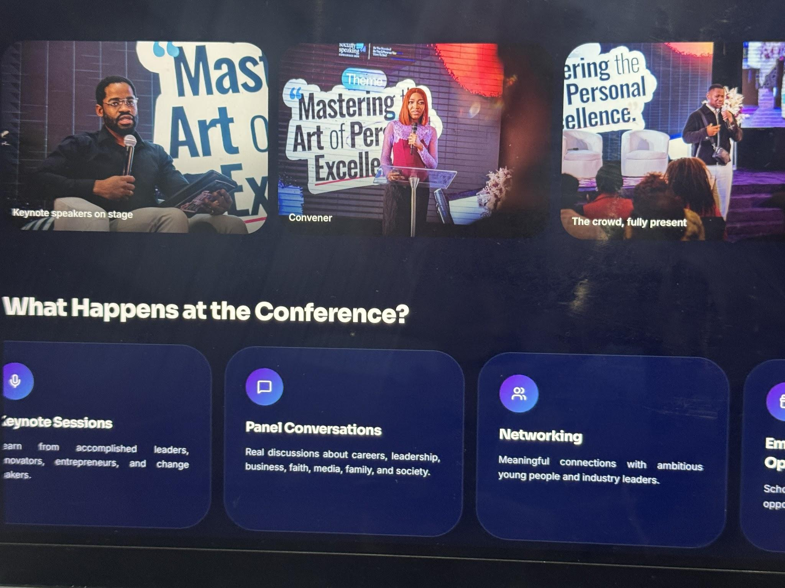
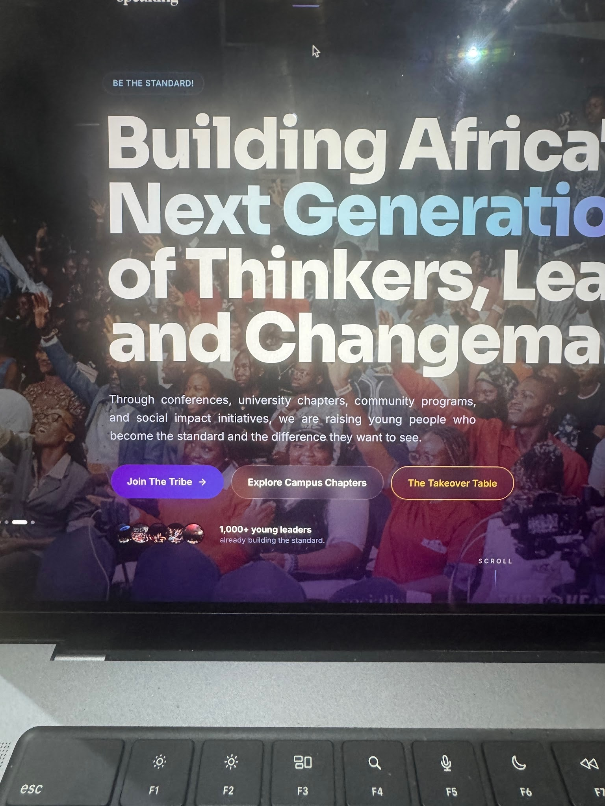
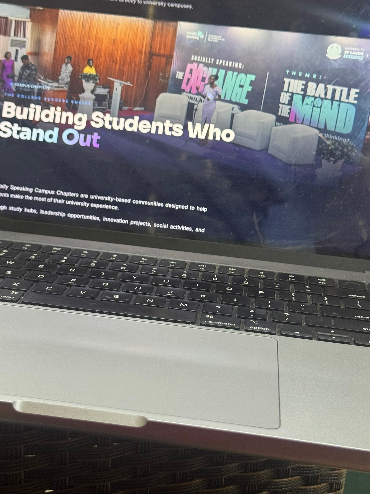
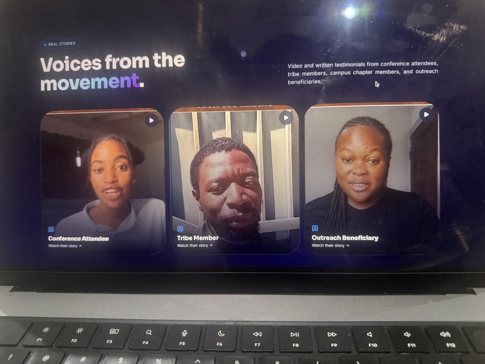
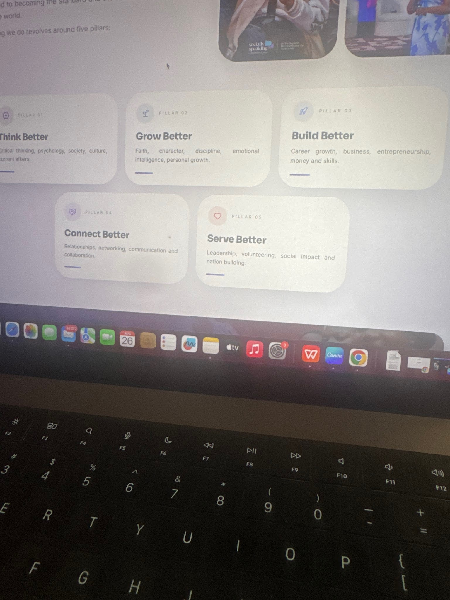
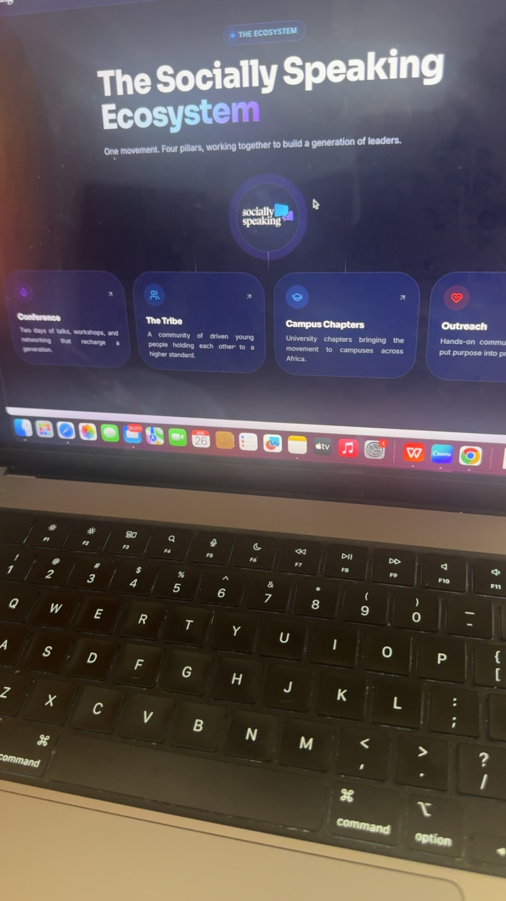
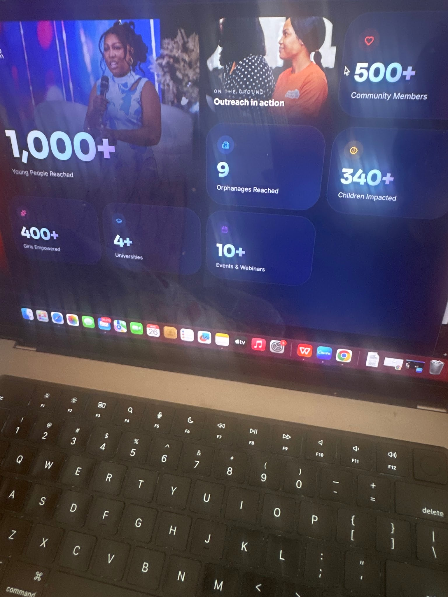

# Website Corrections

SECTION 8
SOCIALLY SPEAKING OUTREACH
Headline:
Success Must Produce Contribution.
Copy:
We believe success is making the world around you better than how you met it.
Socially Speaking Outreach is our social impact arm, where we turn service into action through initiatives designed to support children, students, educators, and communities.
OUR OUTREACH INITIATIVES
ORPHANAGE OUTREACH
Supporting children across orphanages through relief materials, educational support, meaningful experiences, and direct engagement.
Impact:
9 Orphanages Reached
340+ Children Impacted
HYGIENE & DIGNITY OUTREACH
Our secondary school initiative focused on menstrual health, hygiene education, confidence, and dignity for young girls.
Beyond distributing hygiene essentials, we equip girls with practical knowledge about their bodies, personal care, and wellbeing.
Impact:
400+ Secondary School Girls Reached
TEACHERS’ APPRECIATION OUTREACH
Honouring the People Who Build Generations.
An appreciation initiative created to recognise and support public school teachers whose daily work continues to shape the lives and futures of young Nigerians.
Through relief packages, appreciation resources, and direct engagement, we celebrate teachers while providing practical support for those serving within Nigeria’s public education system.
2026 Goal:
100+ Public School Teachers
₦50,000 Worth of Support Per Teacher
IMPACT HIGHLIGHTS
9
Orphanages Reached
340+
Children Impacted
400+
Girls Reached
100+
Teachers Targeted
[SEE OUR IMPACT]… Instagram account link
For the design, I would make the three initiatives three large editorial-style panels with strong photography rather than small cards. As the visitor scrolls, each outreach takes over the screen with its impact number displayed prominently. This gives the outreach work the weight it deserves.

SOCIALLY SPEAKING CONFERENCE 2026
The next chapter is here.
Socially Speaking Conference returns on December 5, 2026, bringing together a new generation of young people for another defining experience of learning, conversations, connection, and growth.
DATE
Saturday, December 5, 2026
WHAT TO EXPECT
• Powerful keynote sessions
• Honest, relevant conversations
• Panel sessions
• Real stories and experiences
• Practical learning
• Networking and meaningful connections
• Opportunities for growth and impact
REGISTRATION
Registration for Socially Speaking Conference 2026 is now open.
Secure your spot and be part of the next Socially Speaking Conference.
[REGISTER FOR SSC 2026]……. Let this also pop up on the home page from time to time.
Button should link directly to the conference registration page.

For more information: sociakkyspeaking.tribe Instagram.
Visually, I would make the 2026 registration the final, dominant part of the Conference section. After visitors scroll through 2024 and 2025, the design transitions into a large “2026” with the December 5 date and registration button. It turns the conference history into a progression toward the edition they are being invited to attend.

SOCIALLY SPEAKING CONFERENCE 2026
THE TAKEOVER GENERATION
Saturday, December 5, 2026
Registration is now open.
REGISTRATION INFORMATION
Full Name
Email Address
Phone Number / WhatsApp Number (type out an accurate number)
Age:
• Under 18
• 18–21
• 22–25
• 26–30
• 31–35
• 36+
Gender
Female/Male
City / State
School / University / Organisation
Occupation / Current Status
(Student, Employed, Entrepreneur, Creative, Other)
How did you hear about Socially Speaking Conference?
• Instagram / Social Media
• WhatsApp
• Friend or Family
• Socially Speaking Community
• Church / School / Organisation
• Others
Have you attended a Socially Speaking Conference before?
• Yes
• No
Which Socially Speaking Conference have you attended?
• 2024: Mastering the Art of Personal Excellence
• 2025: The Takeover Conference
• This will be my first
What are you hoping to gain from SSC 2026?
[REGISTER FOR SSC 2026]
After Registration:
Thank you for registering for Socially Speaking Conference 2026.
Your registration has been received. Further information about the conference will be sent to your email shortly.

Subject: You’re Registered for Socially Speaking Conference 2026
Email:
Hi [First Name],
Your registration for Socially Speaking Conference 2026 is confirmed.
Date: Saturday, December 5, 2026
You’re officially part of the experience.
To receive important conference updates, announcements, and information leading up to the event, join the official SSC 2026 WhatsApp community below.
[JOIN THE WHATSAPP COMMUNITY]
Please join immediately so you don’t miss important updates.
We look forward to having you at Socially Speaking Conference 2026.
Socially Speaking Team

Campus chapters section:
Include our Instagram account.
sscthe.exchange

Impact Page:
12 outreaches.
240 plus community members
20+ events & webinars

The takeover table should pop up periodically
Also register for SSC2026 should pop up periodically on the home page

THE MEDIA SECTION
MEDIA
Follow the Socially Speaking Ecosystem
Stay connected with each arm of Socially Speaking.
Socially Speaking Community
Main community account
IG/Tiktok: sociallyspeaking.tribe]
YouTube: sociallyspeakingtribe
Socially Speaking Conference
Conference announcements, speakers, highlights and updates.
[Instagram] [TikTok]
Socially Speaking Outreach
Outreach campaigns, impact stories and opportunities to support.
[sociallyspeaking.outreach]
Campus Chapters / The Exchange
Campus conversations, university events and chapter activities.
[sscthe.exchange]
The Takeover Network
Connecting ambitious young leaders, creatives, professionals and changemakers across countries and industries.
[Instagram] [LinkedIn]

The designer should display these as clean account cards with the arm’s logo, account name, handle, and social icons.
Put the links of the various accounts. . Only show accounts that exist. This avoids empty links and keeps the section clean.

Let’s remove these videos. Let’s just put written testimonials (Johanna will send them to you)… let’s also remove the writeup “video and written…. Outreach beneficiaries”

Let’s remove the write up on the pictures.

Let’s write “Be the Standard. Be the difference you want to see” instead of just “Be the Standard” and make it a bit bigger.
And also let’s put “We are raising young people who are the standard and the difference they want to see.”

I don’t think pictures are necessary here if we aren’t going to put pictures in all the boxes.

Let’s replace this picture with the one where all the volunteers are

THE TRIBE Section
Let’s have a “join the tribe” box here

Centralize the “the socially speaking ecosystem and the “one movement…”

## Preserved Images

